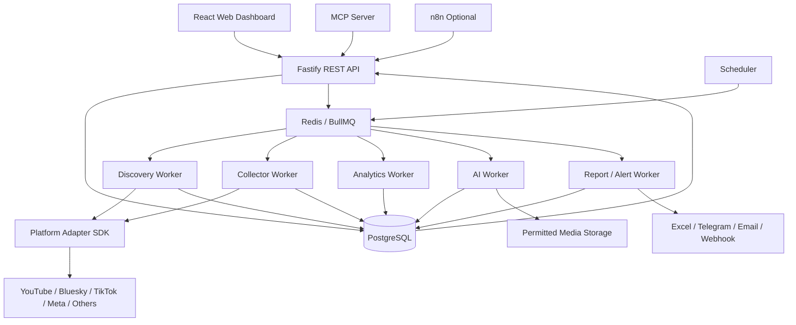
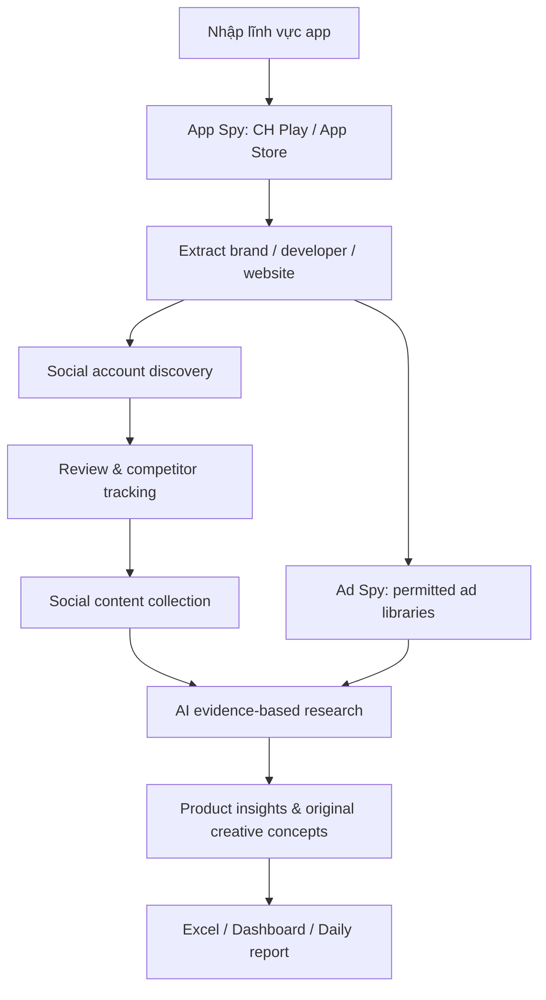

# SOCIAL SPY AUTOMATION SYSTEM

**Master Plan & Technical Specification — v1.0**  
**Ngày:** 26/11/2026  
**Đối tượng:** Developer, AI Coding Agent, Product Owner  
**Trạng thái:** Đặc tả triển khai đề xuất; chưa phải hệ thống đã được kiểm thử.

---

## 0. Hướng dẫn dành cho AI Coding Agent

Đọc toàn bộ tài liệu trước khi triển khai. Thực hiện theo từng phase, ưu tiên khả năng lấy dữ liệu thật và một luồng end-to-end hoạt động được trước khi mở rộng tính năng.

- Không tạo dữ liệu giả rồi trình bày như kết quả thu thập thật. Mock chỉ dùng cho test hoặc demo có nhãn rõ ràng.
- Không tự giả định API có quyền tìm kiếm tài khoản, bài đăng hoặc truy cập media đối thủ. Kiểm tra tài liệu, quyền truy cập, điều khoản, quota và thử nghiệm có xác thực trước khi bật adapter.
- Không tìm cách vượt CAPTCHA, cơ chế kiểm soát truy cập, giới hạn nền tảng hay sử dụng thông tin xác thực trái phép. Nếu nguồn không hỗ trợ, đánh dấu `NOT_SUPPORTED` hoặc `AUTH_REQUIRED`.
- Không hardcode API key, token, mật khẩu, URL nội bộ, cổng chạy hoặc giá provider.
- Tách business logic khỏi UI và adapter. Mọi nguồn dữ liệu phải đi qua interface chung.
- Từng phase phải có code, migration, test, README, hướng dẫn chạy và báo cáo nghiệm thu. Không đánh dấu hoàn thành nếu chưa có bằng chứng test.
- Ưu tiên Windows/macOS, chạy local bằng Docker Compose; có đường nâng cấp lên cloud. Không yêu cầu server riêng trong giai đoạn thử nghiệm.
- Các quyết định kiến trúc dưới đây là mặc định đề xuất. Nếu thay đổi, ghi lại lý do và ảnh hưởng trong `docs/adr/`.

## 1. Product vision

Xây dựng một nền tảng Social Intelligence Automation giúp nghiên cứu đối thủ, phát hiện nội dung nổi bật và xu hướng thị trường trên nhiều mạng xã hội. Người dùng cấu hình dự án một lần; hệ thống tự chạy các workflow theo lịch, thu thập dữ liệu hợp lệ, phân tích và gửi báo cáo.

### 1.1. Mục tiêu chính

1. Tìm đối thủ theo keyword, lĩnh vực, tên sản phẩm hoặc URL tài khoản.
2. Theo dõi tài khoản, bài đăng, video và số liệu được phép truy cập.
3. Phát hiện nội dung mới, tăng trưởng bất thường và chủ đề có tín hiệu nổi bật.
4. Phân tích creative bằng AI: hook, kịch bản, CTA, thông điệp, định dạng.
5. Tự động lập lịch, kiểm soát chi phí, retry, theo dõi tình trạng từng nguồn.
6. Xuất Excel, CSV, JSON; gửi Telegram/email/webhook; cung cấp REST API và MCP.
7. Mở rộng để kết nối App Spy, Ad Spy và hệ thống nghiên cứu thị trường chung.

### 1.2. Phạm vi MVP

- Một người dùng hoặc một workspace local; chưa cần SaaS multi-tenant, thanh toán hay phân quyền phức tạp.
- Hai adapter hoạt động với dữ liệu thật: ưu tiên YouTube và Bluesky để xác minh nền tảng kỹ thuật. TikTok là ưu tiên kinh doanh tiếp theo; chỉ bật khi có nguồn hợp lệ được kiểm thử.
- Tìm kiếm, thêm URL tài khoản, đồng bộ bài đăng, dashboard, job queue, lịch chạy, Excel export, báo cáo và REST API/MCP cơ bản.
- Facebook, Instagram, Threads là các adapter mở rộng theo kết quả Phase 0; không cam kết đầy đủ chỉ số ở mọi nguồn.
- Chưa tự viết visual workflow editor. Dùng workflow template và n8n tùy chọn; bổ sung giao diện kéo thả sau.
- Chưa tải hàng loạt video, lưu toàn bộ bình luận hoặc xây dựng AI agent có quyền tự mở rộng ngân sách.

### 1.3. Ví dụ use case

Dự án `Depth Clock Wallpaper`: nhập `live wallpaper`, `depth wallpaper`, `3d parallax wallpaper`; AI sinh keyword, hệ thống tìm nội dung và kênh liên quan, người dùng duyệt đối thủ, sau đó tự đồng bộ và báo cáo creative đáng nghiên cứu.

Dự án `Women Workout`: tìm thương hiệu app, kênh hướng dẫn workout, video dạng thử thách 30 ngày; phân loại đối thủ trực tiếp và creator; đề xuất concept video mới dựa trên bằng chứng, không sao chép creative gốc.

## 2. Tham khảo sản phẩm và nguồn dữ liệu

| Sản phẩm | Tham khảo |
|---|---|
| [Rival IQ](https://www.rivaliq.com/) | Competitor benchmarking, alerts, reporting |
| [Socialinsider](https://www.socialinsider.io/) | Social analytics, so sánh đối thủ |
| [Metricool](https://metricool.com/) | Dashboard và quản lý nhiều nền tảng |
| [Exolyt](https://exolyt.com/) | TikTok analytics, social listening |
| [Apify](https://apify.com/store) | Data collector, mô hình API provider |
| [Competitor Spy](https://github.com/kirillsaven/competitors_spy) | Repository tham khảo pipeline monitoring |
| [n8n](https://n8n.io/) | Workflow orchestration, trigger, integration |

Các repository chỉ là tài liệu tham khảo; cần kiểm tra license, chất lượng code và khả năng chạy trước khi tái sử dụng. Không giả định các dịch vụ thương mại sử dụng một API cụ thể nếu họ không công bố.

## 3. Kiến trúc tổng thể

Mô hình **Modular Monolith + Background Workers**, API-first, provider-agnostic.



### 3.1. Technology stack

| Layer | Công nghệ đề xuất |
|---|---|
| Frontend | React, Vite, TypeScript, Tailwind CSS, shadcn/ui, Recharts |
| API | Node.js LTS, TypeScript, Fastify, OpenAPI, Zod |
| Database | PostgreSQL, Prisma migrations |
| Queue | Redis, BullMQ |
| Scheduling | BullMQ Job Scheduler; một nguồn lịch nội bộ duy nhất |
| External orchestration | n8n self-hosted, tùy chọn, gọi API nghiệp vụ |
| AI | LLM provider interface; OpenAI/Gemini/model local tùy cấu hình |
| Advanced media | Python, FastAPI, FFmpeg, speech-to-text, OCR, vision (phase sau) |
| Vector search | pgvector (chỉ khi cần) |
| Storage | Local volume; MinIO/R2 khi mở rộng và có quyền lưu |
| Exports | ExcelJS, CSV streaming, JSON |
| MCP | TypeScript MCP SDK; local stdio trước, HTTP có auth sau |
| Testing | Vitest, Playwright UI tests, integration/contract tests |
| Deployment | Docker Compose, Windows PowerShell/batch, macOS shell |
| Monitoring | Structured logs, health endpoints, metrics; Prometheus/Grafana tùy chọn |

Pin phiên bản runtime/dependency và commit lockfile. Không yêu cầu Python, pgvector, object storage hoặc n8n để chạy core MVP.

### 3.2. Module map

| ID | Module | Nhiệm vụ |
|---|---|---|
| M01 | Project Manager | Cấu hình dự án, phạm vi, ngân sách |
| M02 | Keyword Engine | Seed, mở rộng, loại trùng, phân loại |
| M03 | Discovery Engine | Search, tìm ứng viên, relevance |
| M04 | Competitor Manager | Brand, account, mapping, duyệt |
| M05 | Collector SDK | Provider, pagination, normalize, capabilities |
| M06 | Automation Engine | Schedules, workflows, jobs, events |
| M07 | Data Warehouse | Storage, provenance, dedup, retention |
| M08 | Analytics/Viral Engine | Chỉ số và phát hiện bất thường khi được phép |
| M09 | Trend Engine | Chủ đề, biến động, tín hiệu xu hướng |
| M10 | AI Intelligence | Phân tích metadata/media được phép, creative ideas |
| M11 | Reporting/Alerts | Dashboard, báo cáo, Excel, notifications |
| M12 | API/MCP Gateway | REST, tool calls, jobs, integrations |
| M13 | Policy & Budget | Quyền, quota, chi phí, data lifecycle |

## 4. Phase 0 — Data Source Feasibility (bắt buộc)

Không xây dựng cả hệ thống dựa trên giả định rằng các nền tảng cho phép lấy toàn bộ dữ liệu đối thủ. Tạo bộ collector CLI/test harness độc lập trước.

### 4.1. Ma trận nguồn ưu tiên

| Platform | Nguồn ưu tiên | Hạn chế/điều kiện cần xác minh |
|---|---|---|
| YouTube | [Data API v3](https://developers.google.com/youtube/v3) | API key, quota, trường stats, quy định refresh/delete/derived metrics |
| TikTok | Provider hợp lệ, ví dụ [Apify Store](https://apify.com/store) | Display API cần chủ tài khoản cấp quyền; Research API không mặc định phù hợp nghiên cứu thương mại; xác minh license provider |
| Facebook | [Graph API](https://developers.facebook.com/docs/graph-api/) hoặc provider hợp lệ | Page public content access, app review, scope; không mặc định search tùy ý |
| Instagram | [Instagram API](https://developers.facebook.com/docs/instagram-platform/) / Business Discovery | Tài khoản chuyên nghiệp, quyền và trường dữ liệu được cấp |
| Threads | [Threads API](https://developers.facebook.com/docs/threads/) | Xác minh quyền discovery/search và phạm vi chỉ số công khai |
| Bluesky | [AT Protocol](https://atproto.com/) / [Bluesky API](https://docs.bsky.app/) | Public API, rate limit, dữ liệu thực tế theo endpoint |
| Reddit | [Reddit Data API](https://www.reddit.com/dev/api/) | Điều khoản sử dụng thương mại, quyền truy cập, xóa dữ liệu |
| X | [X API](https://docs.x.com/) | Giá, quota, quyền và chính sách hiện hành |
| Pinterest | [Pinterest API](https://developers.pinterest.com/) | Quyền truy cập và khả năng tìm kiếm |
| LinkedIn | [LinkedIn API](https://learn.microsoft.com/en-us/linkedin/) | Phạm vi partner/app được duyệt; hạn chế dữ liệu đối thủ |

Provider thay thế chỉ được sử dụng nếu có quyền, điều khoản phù hợp và provenance rõ ràng; mua API dữ liệu không tự động cấp quyền lưu hoặc phân tích vô hạn.

### 4.2. PoC test cases cho từng nguồn

- Validate credentials; phân biệt key sai, hết hạn, thiếu scope, quota hết.
- Resolve 3–5 URL/username công khai thành external account ID.
- Search theo 3 keyword khác nhau; thử phân trang và ngôn ngữ/thị trường nếu hỗ trợ.
- Lấy profile, 10–20 bài gần nhất, metrics và chi tiết từng bài.
- Kiểm tra trường bị ẩn, null, video bị xóa/private, lỗi 429/5xx.
- Chạy tối thiểu 3 lần ở các thời điểm khác nhau trong ngân sách; ghi nhận latency, tỷ lệ thành công, completeness và cost thực tế.
- Kiểm tra ID có ổn định không, cursor có dùng lại được không, URL media có hết hạn không.
- Xác minh retention, quyền tạo chỉ số dẫn xuất, quyền export và quyền xử lý media. Lưu bằng chứng tài liệu và ngày kiểm tra.
- Chỉ dùng media thử nghiệm được phép. Không dùng private API bị hạn chế hoặc bypass cơ chế bảo vệ.

### 4.3. Output Phase 0

`docs/feasibility/<platform>.md`, file capability JSON, test log đã loại thông tin xác thực, mẫu response được phép lưu, dự toán chi phí.

Ví dụ capability record:

```json
{
  "platform": "tiktok",
  "provider": "provider_under_evaluation",
  "status": "UNVERIFIED",
  "capabilities": {
    "resolveAccount": "UNKNOWN",
    "searchAccounts": "UNKNOWN",
    "searchPosts": "UNKNOWN",
    "getProfile": "UNKNOWN",
    "listPosts": "UNKNOWN",
    "getPostMetrics": "UNKNOWN",
    "listComments": "UNKNOWN"
  },
  "policy": {
    "allowHistoricalSnapshots": false,
    "allowDerivedMetrics": false,
    "allowMediaProcessing": false,
    "allowExport": false,
    "retentionDays": null
  }
}
```

Các giá trị `false` là deny-by-default trước khi xác minh, không phải kết luận chính sách của nền tảng.

**Gate:** chỉ bật provider production khi PoC thành công, capability/policy được xác nhận, chi phí dự đoán được, không cần truy cập trái phép. Không có nguồn phù hợp thì đánh dấu `BLOCKED` và tiếp tục với adapter khác.

## 5. Data Collector SDK

### 5.1. Interface

```typescript
interface PlatformAdapter {
  readonly platform: Platform;
  readonly providerId: string;
  getCapabilities(): Promise<Capabilities>;
  validateCredentials(): Promise<CredentialStatus>;
  healthCheck(): Promise<HealthStatus>;
  resolveAccount(input: ResolveAccountInput): Promise<Account>;
  searchAccounts(input: SearchInput): Promise<Page<Account>>;
  searchPosts(input: SearchInput): Promise<Page<Post>>;
  getProfile(accountId: string): Promise<Account>;
  listPosts(input: ListPostsInput): Promise<Page<Post>>;
  getPostDetail(postId: string): Promise<Post>;
  getPostMetrics(postIds: string[]): Promise<PostMetrics[]>;
  listComments(input: ListCommentsInput): Promise<Page<Comment>>;
}

type Page<T> = {
  items: T[];
  nextCursor: string | null;
  collectedAt: string;
  usage: { requests: number; records: number; costUsd?: number };
  warnings: string[];
};
```

Tất cả input phải có validation, limit, timeout và cancellation khi phù hợp. Adapter không hỗ trợ method phải trả lỗi có kiểu rõ ràng, không trả mảng rỗng để che lỗi.

### 5.2. Pipeline xử lý

```text
Validate input & capabilities
 -> Check policy, quota, budget, credentials
 -> Reserve budget / acquire rate limit
 -> Call provider / paginate
 -> Validate response schema
 -> Normalize + attach provenance
 -> Upsert account/posts + allowed metrics
 -> Commit checkpoint
 -> Reconcile usage / emit domain event
```

### 5.3. Lỗi chuẩn hóa

`NOT_SUPPORTED`, `AUTH_REQUIRED`, `AUTH_EXPIRED`, `PERMISSION_DENIED`, `RATE_LIMITED`, `QUOTA_EXCEEDED`, `BUDGET_EXCEEDED`, `NOT_FOUND`, `PRIVATE_OR_REMOVED`, `PROVIDER_UNAVAILABLE`, `SCHEMA_CHANGED`, `POLICY_BLOCKED`, `TIMEOUT`, `INVALID_INPUT`, `UNKNOWN_ERROR`.

Retry lỗi tạm thời; không retry tự động lỗi permission, policy hoặc credentials. Với 429, dùng Retry-After nếu có và không dùng nhiều tài khoản để né quota. Failover chỉ khi provider thay thế đã được cấu hình, policy tương thích và ngân sách cho phép.

## 6. Data model & storage

### 6.1. Quy tắc

- Internal UUID; external ID lưu kiểu string; unique `(platform, external_id)` theo từng loại entity.
- Tất cả timestamp lưu UTC; UI và schedule hiển thị timezone cấu hình (mặc định `Asia/Ho_Chi_Minh`).
- `null` nghĩa là thiếu/không hỗ trợ/không được cung cấp; không thay bằng 0. Lưu lý do thiếu nếu có.
- Phân biệt `published_at`, `first_seen_at`, `collected_at`, `updated_at`.
- Mỗi dữ liệu có provider, nguồn, ngày thu thập, policy ID, freshness và schema version.
- Không trộn chỉ số có định nghĩa khác nhau; lưu metric definition/version khi cần.
- Không tự suy diễn follower, country, views, doanh thu hay chi phí ads đối thủ.

### 6.2. Bảng dữ liệu

| Bảng | Trường chính / chức năng |
|---|---|
| projects | id, name, niche, platforms, languages, markets, timezone, budget, status |
| competitors | id, brand_name, website, category, notes |
| social_accounts | id, platform, external_id, username, name, profile_url, bio, avatar_url, status |
| competitor_accounts | competitor_id, account_id, match_confidence, evidence_url, verified_at |
| project_accounts | project_id, account_id, relevance_score, approval_status, priority, next_sync_at |
| keywords | project_id, text, normalized_text, language, origin, status, priority |
| keyword_groups | project_id, name, parent_id |
| discovery_candidates | project_id, account_id, evidence, score, approval_status |
| posts | id, platform, external_id, account_id, url, type, title, caption, published_at, first_seen_at, status |
| post_media | post_id, type, thumbnail_url, authorized_asset_ref, expires_at |
| post_metrics | post_id, collected_at, views, likes, comments, shares, saves, provider_id, policy_id |
| account_metrics | account_id, collected_at, followers, following, posts_count, provider_id, policy_id |
| comments | post_id, external_id, allowed_text, collected_at, expires_at (optional) |
| search_results | project_id, keyword_id, account_id/post_id, rank, provider, collected_at |
| raw_responses | provider_id, storage_ref, schema_version, expires_at (optional, TTL) |
| collection_runs | job_id, provider, request_count, records, status, latency, cost |
| sync_cursors | account_id, provider_id, cursor, watermark, last_success_at |
| viral_scores | project_id, post_id, score, version, features, scored_at, policy_id |
| trends / trend_snapshots | topic, window, sample_size, signals, confidence, computed_at |
| content_analysis | post_id, model, prompt_version, input_hash, result_json, evidence, confidence |
| creative_ideas | project_id, concept, sources, assumptions, status |
| workflows / workflow_versions | type, version, config, enabled |
| workflow_runs | workflow_id, status, started_at, ended_at, summary |
| jobs / job_logs | queue job reference, stage, error_code, attempts, timestamps |
| schedules | workflow_id, cron/interval, timezone, enabled, next_run_at |
| providers / credentials | configuration, capability, secret_ref; không lưu plaintext secret |
| usage_logs | provider, project, job, unit, quantity, reserved/actual_cost |
| data_policies | source, allowed_operations, retention, refresh, version, verified_at |
| notifications / reports | project, type, dedup_key, status, storage_ref, sent_at |
| audit_logs | actor, action, target, timestamp, redacted_metadata |

Indexes: `(account_id, published_at DESC)`, `(post_id, collected_at DESC)`, `(project_id, approval_status)`, `(next_sync_at)`, unique cho notification dedup, job idempotency và normalized keyword. Chỉ partition metrics khi số liệu thực tế cần. Foreign keys và migration có test.

### 6.3. Canonical post example (synthetic fixture)

```json
{
  "platform": "tiktok",
  "external_id": "fixture-post-001",
  "account_id": "fixture-account-001",
  "url": "https://example.com/post/001",
  "content_type": "video",
  "title": null,
  "caption": "Example caption",
  "hashtags": ["wallpaper"],
  "thumbnail_url": null,
  "duration_seconds": 18,
  "published_at": "2026-11-26T06:00:00Z",
  "metrics": {"views": 120000, "likes": 8200, "comments": 320, "shares": null},
  "source": {"provider_id": "fixture", "collected_at": "2026-11-26T07:00:00Z", "policy_id": "test-only"}
}
```

## 7. Automation engine

### 7.1. Workflow lifecycle

`DRAFT -> ENABLED -> PAUSED -> ARCHIVED`. Mỗi lần chạy tạo immutable config/version snapshot. Run states: `QUEUED`, `RUNNING`, `SUCCEEDED`, `PARTIAL_SUCCESS`, `FAILED`, `CANCELLED`, `SKIPPED`.

BullMQ quản lý queue và lịch nội bộ; n8n tùy chọn gọi API `run_workflow`, không tạo lịch trùng với scheduler nội bộ. Workflow dài trả `job_id` ngay. Event delivery có thể at-least-once; consumers phải idempotent.

### 7.2. Workflow catalogue

| ID | Workflow | Trigger mặc định | Output |
|---|---|---|---|
| WF01 | Keyword Expansion | Tạo dự án/manual | Keyword candidates |
| WF02 | Market Discovery | Hằng ngày/manual | Accounts/posts/candidates |
| WF03 | Account Profile Sync | 24 giờ | Profile & allowed snapshots |
| WF04 | New Post Detection | 2 giờ | New posts/events |
| WF05 | Hot Post Monitoring | 1 giờ | Updated allowed metrics |
| WF06 | Normal Post Monitoring | 12 giờ | Updated allowed metrics |
| WF07 | Viral Detection | Metrics updated | Score/alert nếu được phép |
| WF08 | AI Content Analysis | Selected content/manual | Structured analysis |
| WF09 | Trend Detection | 6 giờ | Topic signals |
| WF10 | Competitor Expansion | Hằng tuần | New candidates |
| WF11 | Daily Report | 06:00 hằng ngày | Report + notification |
| WF12 | Weekly Report | Thứ Hai 08:00 | Weekly report |
| WF13 | Provider Health Check | 30 phút | Health status |
| WF14 | Policy Cleanup & Refresh | Hằng ngày | Delete/refresh/reconcile |
| WF15 | Backup | Hằng ngày | Backup metadata |
| WF16 | Budget & Quota Guard | Trước mọi provider/AI call | Allow/deny/reschedule |
| WF17 | Export | Manual/scheduled | Excel/CSV/JSON |

Đây là lịch đề xuất, không phải tần suất bắt buộc. Policy, quota, cost và thời gian máy online luôn được ưu tiên.

### 7.3. WF01–02: Keyword & discovery

Input: project, seed keywords, platforms, market/language preferences, date range, max candidates, budget.

1. AI sinh keyword đồng nghĩa, long-tail, hashtag, vấn đề khách hàng, tên sản phẩm/brand liên quan. Có chế độ nhập tay hoặc rule-based nếu chưa cấu hình AI.
2. Chuẩn hóa và loại trùng; giới hạn keyword/run; người dùng có thể sửa/duyệt.
3. Fan-out theo platform và keyword có capability search; nguồn không hỗ trợ search thì yêu cầu URL hoặc bỏ qua kèm lý do.
4. Thu thập theo trang, lưu kết quả; kiểm tra ngân sách trước từng trang.
5. Extract account từ kết quả; enrich profile và lấy một số nội dung được phép.
6. Chấm relevance 0–100 dựa trên metadata và bằng chứng; phân loại direct competitor, adjacent competitor, creator, publisher, irrelevant.
7. Đưa ứng viên vào review queue; mặc định **không tự thêm**. Auto-track là opt-in với ngưỡng và giới hạn.
8. Tạo account sync job cho các ứng viên được duyệt.

Output có source URL, provider, lý do phân loại, confidence, search coverage và các nguồn chưa chạy được.

### 7.4. WF03–06: Account & post monitoring

- Initial backfill: resolve account, lấy profile, tối đa 20 bài hoặc theo cap; lưu checkpoint.
- Incremental sync: ưu tiên bài mới; cursor/watermark kèm overlap nhỏ để xử lý bài ghim, bài edit, dữ liệu đến trễ. Upsert bằng stable ID.
- Chỉ commit checkpoint sau khi dữ liệu trang đã commit; job bị dừng có thể resume an toàn.
- Metrics refresh: batch khi API cho phép; tách lịch profile khỏi lịch post metrics.
- Trạng thái bài bị xóa/ẩn: xác minh theo provider, đánh dấu unavailable; chạy policy deletion nếu cần. Không mặc định một lỗi network là bài bị xóa.
- Tần suất adaptive: bài mới 1–2 giờ; nội dung nổi bật 30–60 phút; bình thường 12 giờ; cũ hơn 7 ngày 24 giờ; cũ hơn 30 ngày giảm tần suất hoặc dừng.
- Nếu policy không cho phép lưu history, chỉ duy trì dữ liệu hiện tại theo quy tắc refresh/delete, không tính delta trái phép.

### 7.5. WF07: Viral engine (policy-gated)

Chỉ tính toán khi provider/platform cho phép tạo và lưu chỉ số dẫn xuất. Với YouTube, mặc định tắt các chỉ số dẫn xuất và historical analytics chưa được xác minh/chấp thuận; tham chiếu chính sách chính thức trước khi bật.

```text
velocity = (views_now - views_previous) / elapsed_hours
acceleration = velocity_now - velocity_previous
engagement_rate = supported_interactions / valid_denominator
baseline = median metric of comparable posts
```

- Không tính nếu thiếu dữ liệu, khoảng thời gian không hợp lệ hoặc denominator <= 0.
- Tách nhóm theo platform, post format, tuổi nội dung và quy mô account; dùng percentile/robust baseline. Gắn cờ delta âm do correction, không tự đổi thành tăng trưởng dương.
- Điểm đề xuất: 35% velocity + 20% engagement + 20% acceleration + 15% baseline deviation + 10% relevance. Các feature chuẩn hóa 0–100; version hóa công thức.
- Khi thiếu feature, hiển thị `INSUFFICIENT_DATA` hoặc mô hình đã hiệu chỉnh riêng kèm coverage; không giả sử missing = 0.
- Ngưỡng thử nghiệm: 60 trending, 80 viral, 90 breakout. Cần hiệu chỉnh bằng dữ liệu thật; không phải tiêu chuẩn chung của nền tảng.
- Alert dùng cooldown và dedup key theo project/post/event/window; không gửi lặp vô hạn.

### 7.6. WF08: AI intelligence

Chọn top nội dung theo relevance, rule và chỉ số được phép. Giới hạn N nội dung/ngày. Metadata-only mặc định, không tự tải video.

Nếu được phép xử lý media: lấy asset hợp lệ -> FFmpeg trích keyframe/audio -> speech-to-text/OCR -> vision/text AI -> structured result -> xóa asset theo TTL. Nếu không có quyền hoặc asset không khả dụng, phân tích caption/title/thumbnail được phép và ghi rõ phạm vi; không bịa nội dung 3 giây đầu.

Kết quả AI gồm: content category, hook, format, key message, product features, CTA, script structure, visual notes, audience hypotheses, evidence references, confidence, limitations, original creative ideas. Mỗi kết luận có URL nguồn, trường dữ liệu hoặc timestamp media phù hợp. Suy luận audience không phải demographic analytics chính thức.

Output JSON có schema; validate, retry parse có giới hạn; input hash và model/prompt version giúp tránh phân tích trùng. Nội dung đối thủ là untrusted input; không cho caption/comment ra lệnh cho AI gọi tool, lấy secret hoặc tăng ngân sách. Không tự động đăng bài hoặc tương tác với đối thủ.

### 7.7. WF09–10: Trend & competitor expansion

- Gom keyword, hashtag, chủ đề từ tập dữ liệu hợp lệ; chuẩn hóa ngôn ngữ và nhóm semantic nếu có.
- So sánh cửa sổ thời gian tương đương; số bài, số account khác nhau, tín hiệu tương tác và coverage.
- Chỉ gọi là xu hướng trong **tập mẫu đã thu thập**, không khẳng định đại diện toàn nền tảng khi không có dữ liệu đầy đủ.
- Xử lý thay đổi nguồn, sample size nhỏ, duplicate/cross-post, missing metrics; gắn confidence và version.
- Tìm ứng viên từ hashtag/keyword mới mỗi tuần; giới hạn depth, candidate count và ngân sách. Không tạo vòng lặp discovery vô hạn.

### 7.8. WF11–17: Reporting, maintenance, export

Daily report: đối thủ mới, bài mới, nội dung nổi bật, xu hướng, nguồn thất bại, chi phí, đề xuất hành động và link bằng chứng. Weekly report bổ sung thay đổi chiến lược, top themes và coverage. Nếu một nguồn không sync được, báo cáo `PARTIAL_SUCCESS`, không nói không có nội dung mới.

Cleanup: policy refresh/deletion, xóa dữ liệu hết hạn và dữ liệu dẫn xuất liên quan nếu cần. Backup: mã hóa, rotate, có restore test; backup không phải lý do giữ dữ liệu quá hạn.

## 8. Job queue, scheduling và reliability

Queues: `discovery`, `collection`, `analytics`, `ai`, `report`, `notification`, `maintenance`. Concurrency theo nguồn, không áp một ngưỡng cho mọi API.

- Deterministic job key: project + operation + resource + schedule window/config version. Unique key chống enqueue trùng; DB upsert chống xử lý trùng.
- Retry tối đa 3 lần mặc định cho lỗi tạm thời; exponential backoff + jitter; tôn trọng Retry-After. Sau cùng đưa vào dead-letter queue, có nút retry có kiểm soát.
- Timeout per request/job, heartbeat, stalled-job recovery, cooperative cancellation, pause/resume per workflow/provider.
- Circuit breaker khi provider lỗi liên tục, thử half-open có kiểm soát. Không retry hàng loạt khi key hết hạn.
- Job có checkpoint; trạng thái từng account/page hiển thị rõ. Thành công một phần vẫn lưu dữ liệu hợp lệ.
- Sau restart, reconcile job đang chạy và schedule; không chạy bù vô hạn. Mặc định một catch-up run cho schedule bị lỡ nếu được bật.
- Graceful shutdown; release resources, reconcile reservations; queue persistence; log correlation ID.
- Manual run và scheduled run cùng dùng locking/dedup rule.

## 9. Budget, quota & policy engine

### 9.1. Budget guard

Mỗi API/AI call phải đi qua `authorize -> reserve -> execute -> reconcile`. Reservation atomic theo project/provider/day/month để các worker không chi vượt đồng thời. Chi phí chưa xác định thì áp upper bound hoặc yêu cầu phê duyệt. Nếu actual cost lớn hơn dự kiến, khóa call mới và cảnh báo; không tuyên bố hard cap tuyệt đối nếu provider không đảm bảo.

```yaml
project_defaults:
  timezone: Asia/Ho_Chi_Minh
  auto_track: false
  daily_budget_usd: 5
  monthly_budget_usd: 100
  max_accounts: 50
  max_keywords_per_run: 20
  max_results_per_search: 30
  initial_posts_per_account: 20
  max_ai_analysis_per_day: 10
  max_retries: 3
  job_timeout_seconds: 600
  on_budget_exceeded: pause
  on_rate_limit: reschedule
  on_provider_failure: alert
```

Các giá trị là default đề xuất; người dùng cấu hình lại. Quota tính theo đơn vị thật của API (requests, quota units, events, records, tokens, compute time).

Dự toán minh họa: 50 account × 10 bài × 2 lượt/ngày × 30 ngày = 30.000 bản ghi/tháng. Nếu giả định $2/1.000 bản ghi thì $60/tháng tiền refresh metrics. Chưa gồm discovery, profile, AI, phí khởi chạy, media và hạ tầng. Không phải báo giá provider. Dùng dữ liệu Phase 0 để lập ngân sách thực.

### 9.2. Policy guard

Mỗi provider có policy version, allowed operations, retention, refresh interval, allowed export, derived analytics, media processing, deletion rules. Deny-by-default khi chưa xác minh. Kiểm tra lúc thu thập, phân tích, export, backup và cleanup. Khi policy thay đổi, tạm dừng operation ảnh hưởng, re-evaluate dữ liệu đã lưu.

Tài liệu YouTube: [Developer Policies](https://developers.google.com/youtube/terms/developer-policies), [Terms of Service](https://developers.google.com/youtube/terms/api-services-terms-of-service). Xác minh các yêu cầu lưu/refresh/delete và hạn chế derived metrics theo trường hợp cụ thể; không giả định lịch sử lưu vô thời hạn.

Chỉ thu thập dữ liệu cần thiết cho nghiên cứu nội dung/brand công khai; không xây dựng hồ sơ cá nhân nhạy cảm, không thu thập thông tin riêng tư không cần thiết. Có chức năng xóa account/project và dữ liệu phụ thuộc theo chính sách.

## 10. Web dashboard & UX

Thiết kế desktop-first, responsive, có light/dark mode. Ưu tiên bảng dữ liệu có filter, sort, pagination phía server; không load toàn bộ database lên browser. Mọi số liệu hiển thị nguồn, thời điểm cập nhật và dấu hiệu thiếu dữ liệu.

| Screen | Chức năng |
|---|---|
| Dashboard | Tổng quan projects, tracked accounts, posts mới, coverage, chi phí, job status |
| Projects | Tạo/sửa dự án, seed keyword, platform, lịch, ngân sách |
| Discovery | Search, relevance, evidence, duyệt hàng loạt, nhập URL/CSV |
| Competitors | Brand và account mapping, priority, pause/track, profile |
| Account Detail | Profile, posts, metrics được phép, sync history, errors |
| Content Explorer | Grid/table, thumbnail, caption, link gốc, filters, saved items |
| Viral Feed | Điểm/tín hiệu nổi bật khi policy cho phép, giải thích score |
| Trends | Topic, time windows, coverage, supporting posts |
| Keywords | Nhóm từ khóa, AI expansion, relevance, trạng thái |
| AI Intelligence | Phân tích metadata/media, confidence, evidence, model version |
| Creative Ideas | Ý tưởng mới, tham chiếu, trạng thái review |
| Automations | Template, schedule, enable/pause, manual run, config history |
| Job Monitor | Progress, partial success, retry/cancel, logs đã redacted |
| Data Sources | Credential setup, capabilities, health test, quotas |
| Reports | Daily/weekly, Excel/CSV/JSON export, lịch sử |
| Alerts | Rules, channels, cooldown, notification history |
| Usage & Cost | Budget, reserved vs actual usage, breakdown provider/project |
| Settings | Port, timezone, retention, backup, AI configuration |

### 10.1. Content Explorer filters

Platform, account, project, keyword, hashtag, language, date, format, raw views/likes/comments được phép, viral score nếu được phép, analyzed status, freshness, provider, saved status. Filter quốc gia chỉ dùng khi có dữ liệu đáng tin cậy; không suy diễn từ tên tài khoản.

Post detail: thumbnail hoặc link embed hợp lệ, original URL, author, published time, metrics với collected time, provenance, analysis, limitations. Link external mở an toàn. Không mặc định lưu video hoặc proxy media bị hạn chế.

### 10.2. UX states

Loading, empty result, unsupported, missing credential, insufficient permission, rate limited, budget paused, partial result, stale data, removed content. Empty state khác lỗi. Show last successful sync và next schedule, cho phép manual retry đúng phạm vi.

### 10.3. Workflow builder (giai đoạn sau)

Dùng React Flow, workflow JSON versioned, validate DAG, không cho loop vô hạn. Node groups: Trigger (manual/schedule/webhook/event), Collector, Search, Transform, Filter, Merge, IF/Switch, Bounded Loop, Wait, Database, AI, Analytics, Export, Notification, HTTP/MCP integration. Mỗi node có input/output schema, timeout, error policy, secret reference. UI kéo thả không tự thực thi code tùy ý; các custom script phải sandbox và được người quản trị cấp phép.

## 11. REST API & MCP

REST base `/api/v1`; OpenAPI docs; UUID, cursor pagination, filter whitelist, standardized error envelope. API local mặc định bind localhost, không public Redis/Postgres. Nếu triển khai remote phải có authentication, HTTPS, authorization theo workspace.

| Method / route | Mục đích |
|---|---|
| GET/POST `/projects` | List/create project |
| GET/PATCH/DELETE `/projects/:id` | Detail/update/delete |
| POST `/projects/:id/discover` | Queue discovery |
| POST `/projects/:id/keywords/expand` | Queue keyword expansion |
| GET `/projects/:id/candidates` | Review candidates |
| POST `/projects/:id/candidates/approve` | Duyệt account |
| GET/POST `/accounts` | List/resolve/track accounts |
| GET `/accounts/:id` | Account detail |
| POST `/accounts/:id/sync` | Manual sync |
| PATCH `/accounts/:id/tracking` | Pause/priority/settings |
| GET `/posts` | Content query |
| GET `/posts/:id` | Post detail |
| GET `/posts/:id/metrics` | Allowed metrics/history |
| POST `/posts/:id/analyze` | Queue AI analysis |
| GET `/analytics/viral` | Allowed viral results |
| GET `/analytics/trends` | Trend results |
| GET/POST `/workflows` | Workflow configs |
| POST `/workflows/:id/run` | Start run |
| PATCH `/workflows/:id` | Schedule/enable/pause |
| GET `/jobs/:id` | Job status |
| POST `/jobs/:id/cancel` | Cancel job |
| POST `/jobs/:id/retry` | Retry job |
| GET `/providers` | Source health/capabilities |
| POST `/providers/:id/test` | Credential/health check |
| GET `/usage` | Quota & cost |
| POST `/reports` | Generate report |
| POST `/exports` | Generate export |
| GET `/exports/:id/download` | Authorized file download |
| GET `/health/live`, `/health/ready` | System health |

Long-running operations return HTTP 202 with `job_id`, `status`, `status_url`, and warnings. Use SSE or polling for progress. Return `409` for conflicting operations, `429` for limits, appropriate permission errors, no secrets in responses.

### 11.1. MCP tool catalogue

`create_project`, `expand_keywords`, `search_accounts`, `search_posts`, `discover_competitors`, `track_account`, `get_profile`, `get_posts`, `get_post_detail`, `get_post_metrics`, `get_growth_history`, `find_viral_posts`, `find_trends`, `analyze_content`, `compare_competitors`, `generate_creative_ideas`, `run_workflow`, `get_job_status`, `cancel_job`, `export_excel`, `generate_report`, `get_provider_capabilities`, `get_usage`.

MCP chỉ là wrapper của service/API hiện tại; không viết collector logic lần thứ hai. Tool input có schema, giới hạn, policy guard. Read-only mặc định; mutation/budget/credential actions có permission rõ ràng. Không cho AI tự thay đổi quota, bỏ qua policy hoặc truy cập secret.

Ví dụ:

```json
{
  "tool": "discover_competitors",
  "arguments": {
    "project_id": "project_001",
    "keywords": ["live wallpaper", "depth wallpaper", "3d wallpaper"],
    "platforms": ["tiktok", "youtube", "facebook", "threads"],
    "limit_per_platform": 30,
    "min_relevance_score": 70,
    "auto_track": false,
    "max_cost_usd": 5
  }
}
```

```json
{
  "job_id": "job_001",
  "status": "QUEUED",
  "warnings": ["Unavailable providers will be skipped with explicit reasons."]
}
```

## 12. Reporting & Excel export

Workbook gồm các sheet `Summary`, `Competitors`, `Accounts`, `Posts`, `Metrics_History` (nếu được phép), `Viral` (nếu được phép), `Trends`, `AI_Analysis`, `Keywords`, `Collection_Log`, `Usage`, `Data_Dictionary`.

- Post row: platform, account, title/caption, published_at, source URL, thumbnail URL nếu được phép, public metrics, collected_at, provider, missing_reason, analysis reference.
- URL gốc click được; không bắt buộc nhúng thumbnail/video để tránh file quá nặng và vấn đề quyền lưu media.
- Xử lý formula injection trong CSV/Excel với dữ liệu do bên ngoài nhập (caption, username, text bắt đầu bằng `=`, `+`, `-`, `@` hoặc control characters).
- Export streaming cho tập dữ liệu lớn; partition file/sheet theo giới hạn định dạng; ghi rõ filter, timezone, time range, coverage, missing values và ngày tạo báo cáo.
- Daily report Telegram/email chỉ gửi summary và link báo cáo, không gửi credential hay dữ liệu không được phép. Webhook có chữ ký khi cần, retry bounded, dedup delivery.

## 13. Security & data governance

- API keys lưu OS keychain/secret store hoặc encrypted at rest với key tách khỏi DB; `.env` local được ignore. Secret không xuất hiện trong logs, exports, prompt, URL query hiển thị.
- Validate URL, chống SSRF (deny private/link-local/metadata endpoints; allowlist provider domains; kiểm tra redirects); không tải arbitrary media URL chưa xác minh.
- Sanitize caption/HTML, chống XSS; parameterized queries, schema validation, upload/file path validation.
- Local-only mặc định; remote deployment có TLS, auth, RBAC cơ bản, CSRF/CORS phù hợp, rate limits.
- Không expose Redis/Postgres ra Internet; backup encrypted; quyền filesystem tối thiểu; dependency audit.
- Log provider request ID, job ID, timestamps, status; không lưu raw secrets hoặc dữ liệu cá nhân không cần thiết.
- AI xử lý dữ liệu từ bên ngoài như dữ liệu, không phải instruction. Validate structured output và evidence; prompt không chứa token.
- Policy cleanup áp dụng cả source, cache, vector embeddings, AI derivatives, exports và backup theo yêu cầu pháp lý/hợp đồng. Cơ chế revoke/remove có audit trail không chứa dữ liệu đã xóa.

## 14. Source code structure

```text
social-spy-automation/
├── apps/
│   ├── web/
│   ├── api/
│   ├── worker/
│   ├── scheduler/
│   ├── mcp-server/
│   └── ai-worker/                 # optional, later
├── packages/
│   ├── shared/
│   ├── config/
│   ├── database/
│   ├── collectors/
│   │   ├── core/
│   │   ├── youtube/
│   │   ├── bluesky/
│   │   ├── tiktok/
│   │   ├── facebook/
│   │   ├── instagram/
│   │   ├── threads/
│   │   └── other-platforms/
│   ├── keyword-engine/
│   ├── discovery-engine/
│   ├── workflow-engine/
│   ├── policy-engine/
│   ├── budget-engine/
│   ├── analytics-engine/
│   ├── ai-engine/
│   ├── report-engine/
│   └── notification-engine/
├── workflows/
│   ├── discovery.json
│   ├── competitor-sync.json
│   ├── viral-monitor.json
│   ├── daily-report.json
│   └── n8n/                       # optional templates
├── infrastructure/
│   ├── docker/
│   └── monitoring/
├── tests/
│   ├── unit/
│   ├── integration/
│   ├── contract/
│   ├── fixtures/                  # explicitly synthetic or permitted
│   └── e2e/
├── docs/
│   ├── ARCHITECTURE.md
│   ├── API_SPEC.md
│   ├── DATABASE.md
│   ├── COLLECTOR_SPEC.md
│   ├── WORKFLOW_SPEC.md
│   ├── DATA_POLICY.md
│   ├── DEPLOYMENT.md
│   ├── RUNBOOK.md
│   ├── feasibility/
│   └── adr/
├── scripts/
│   ├── doctor.*
│   ├── backup.*
│   └── restore.*
├── docker-compose.yml
├── .env.example
├── .gitignore
├── start.bat
├── start.command
├── stop.bat
├── stop.command
└── README.md
```

## 15. Deployment & operations

### 15.1. Local (MVP)

- Docker Compose services: `web`, `api`, `worker`, `scheduler` (hoặc scheduler trong worker với single-owner lock), `postgres`, `redis`.
- Persistent volumes cho DB/Redis/exports. Service healthchecks, migrations chạy trước API, restart policy có kiểm soát.
- Default web port đề xuất `18966`, cấu hình `APP_PORT` trong `.env`. Không hardcode frontend URL; dùng same-origin reverse proxy `/api`. Nếu port bận, script báo cách đổi port hoặc chọn port còn trống rồi in URL thật; không tự kill process khác.
- Windows `start.bat`, macOS `start.command` (cần executable permission). Script kiểm tra Docker, config, port, health rồi mở browser. `stop` chỉ dừng project containers; không xóa volume.
- Có `doctor` kiểm tra dependency, port, DB, Redis, provider readiness; có hướng dẫn backup/restore.
- Automation chỉ hoạt động khi máy đang bật và dịch vụ chạy. Khi máy sleep/tắt, lịch bị lỡ; catch-up policy xử lý khi mở lại.

### 15.2. Cloud (khi cần chạy 24/7)

Chuyển Compose lên VPS hoặc managed container service, dùng persistent PostgreSQL/Redis, TLS, backup, monitoring, secrets. Frontend có thể deploy riêng; không dùng Vercel Functions làm nơi chạy worker dài liên tục. n8n tùy chọn là orchestration layer, không thay thế database/collector/policy engine.

## 16. Roadmap & implementation backlog

Mỗi phase chỉ qua gate khi có code/test evidence. Thời lượng là ước lượng lập kế hoạch cho developer, không phải cam kết; các quyền API có thể làm thay đổi thứ tự.

| Phase | Công việc | Deliverable / gate | Ước lượng |
|---|---|---|---|
| 0 | Data feasibility, test harness, policy matrix | Ít nhất 2 nguồn xác minh thực tế; report nguồn bị block | 3–7 ngày |
| 1 | Monorepo, Compose, DB, REST skeleton, queue, provider SDK | Local start/stop, migration, mock test end-to-end | 5–10 ngày |
| 2 | YouTube/Bluesky live adapters; TikTok/Meta theo khả năng | Contract tests, real-data sync, usage + provenance | 10–20 ngày |
| 3 | Project, keyword, discovery, review, tracking, incremental sync | Seed keyword -> candidate -> approved account -> posts | 5–10 ngày |
| 4 | Scheduled workflows, reliability, policy & budget guards | Restart/retry/cancel, budget tests, job monitor | 7–14 ngày |
| 5 | Web dashboard, content explorer, exports | End-to-end UI + Excel file thật | 7–14 ngày |
| 6 | Allowed analytics, AI analysis, trend engine | Evidence/confidence, policy gates, fixture tests | 7–14 ngày |
| 7 | MCP, Telegram/email, reports, n8n templates | Agent tool call -> job -> export/report | 5–10 ngày |
| 8 | Security, scale, backup, observability, deployment | Restore test, security checks, load report | 7–14 ngày |
| 9 | Visual workflow editor, additional platforms, App/Ad Spy | Versioned workflow DAG, integration contracts | Sau MVP |

### 16.1. Ưu tiên sprint đầu tiên

- [ ] P0-01: tạo repo, ADR và capability matrix.
- [ ] P0-02: viết YouTube PoC CLI với API key do người dùng cấu hình; kiểm tra policy.
- [ ] P0-03: viết Bluesky PoC CLI; kiểm tra public endpoints.
- [ ] P0-04: thử TikTok/Meta nguồn hợp lệ nếu có credential/budget; report blocked nếu thiếu.
- [ ] P0-05: lưu test results, cost, fields, sample payload hợp lệ, source links và ngày kiểm tra.
- [ ] P1-01: scaffolding monorepo, Compose, configurable port, .env.example.
- [ ] P1-02: migrations cho projects/accounts/posts/provider/jobs/policies.
- [ ] P1-03: implement adapter interfaces, canonical types, typed errors, fixtures.
- [ ] P1-04: implement queue, worker, idempotency, scheduler, health endpoints.
- [ ] P1-05: build API endpoints create project/track account/sync/job status.
- [ ] P1-06: chạy một vertical slice từ URL account -> dữ liệu thật -> DB -> UI/API.

## 17. Testing & acceptance criteria

### 17.1. Test strategy

Unit: normalization, missing metrics, relevance rule, score/velocity nếu được phép, policy decisions, budget reservations, dates, CSV formula injection.

Contract: per adapter, pagination, typed errors, credentials, capability checks, rate limit, removed/private resources; fixtures rõ nhãn. Live smoke tests opt-in với credential hợp lệ và ngân sách giới hạn, không chạy mất phí mặc định trong CI.

Integration: PostgreSQL migrations, queue + Redis, transactional upserts, checkpoint resume, concurrent budget reservations, schedule dedup, cancellation, provider failover, cleanup/delete cascade.

E2E: tạo project -> tìm kiếm -> duyệt account -> sync -> xem posts -> xuất Excel; kiểm tra trạng thái source lỗi và partial success; start/stop trên Windows/macOS theo môi trường test thực tế.

### 17.2. MVP acceptance checklist

- [ ] Start/stop local và cổng tùy chỉnh hoạt động trên Windows/macOS đã được thử nghiệm hoặc ghi rõ hệ điều hành chưa test.
- [ ] Ít nhất 2 adapter production có dữ liệu thật, capabilities và policy được xác minh.
- [ ] Có thể nhập keyword, tìm account/post ở nguồn hỗ trợ, import URL thủ công.
- [ ] Review/approve competitor; bật/tắt tracking.
- [ ] Initial và incremental sync chạy tự động; không trùng post khi chạy lại.
- [ ] Missing field hiển thị null/unknown; nguồn lỗi không được trình bày như 0 results.
- [ ] Queue có retry/backoff, timeout, cancel, pause, checkpoint, DLQ.
- [ ] Scheduler không chạy trùng; khôi phục sau restart.
- [ ] Budget guard và quota guard hoạt động khi concurrent jobs.
- [ ] Policy guard chặn lịch sử/derived metrics/media/export không được phép.
- [ ] Dashboard/content explorer hiển thị dữ liệu thật, source URL, collected time.
- [ ] Export Excel/CSV/JSON hợp lệ, có data dictionary và provenance.
- [ ] Daily report hoặc Telegram webhook hoạt động với cấu hình hợp lệ.
- [ ] REST/MCP tool call trả job ID, đọc trạng thái và lấy kết quả.
- [ ] Backup + restore test, audit log, secret redaction, retention cleanup.
- [ ] README, setup, API docs, troubleshooting, limitations và test report đầy đủ.

### 17.3. Mục tiêu vận hành thử (không phải benchmark đã đạt)

Pilot: 1 workspace, 3 projects, tối đa 50 accounts theo dõi, 20 posts/account lần đầu, 2 nguồn thật. Thu thập metrics theo quota/policy. Mục tiêu API đọc bảng p95 dưới 1 giây trên máy thử với dataset pilot, không tính external provider. Báo cáo tỷ lệ job thành công/partial/error, latency, duplicate count, quota/cost, completeness, data freshness. Đo thực tế trước khi tăng quy mô.

## 18. Mở rộng Market Intelligence Suite

Giữ `project_id`, `competitor_id`, canonical brand/product entity và provenance chung. App Spy, Ad Spy, Social Spy là các module độc lập dùng chung API, queue, budgets, policy và reports.



Liên kết account với app/brand bằng website chính thức, link profile, cross-link và bằng chứng. Không tự coi hai tài khoản cùng tên là một thương hiệu. Dữ liệu ads chỉ là dữ liệu thư viện công khai được phép; không suy diễn ngân sách, doanh thu, CPI hay ROAS chính xác của đối thủ.

## 19. Quyết định chốt & open questions

**Chốt mặc định:** local-first, TypeScript, PostgreSQL, BullMQ, adapter SDK, API-first, workflow templates, n8n tùy chọn, Excel export, MCP, AI provider thay thế được. MVP bắt đầu với 2 nguồn xác minh được; không ưu tiên workflow kéo thả trước data engine.

**Cần người dùng hoặc developer xác minh trong Phase 0:**

- Có API key/account/quyền nào cho YouTube, Meta, TikTok và provider thương mại?
- Có chấp nhận provider trả phí hay ưu tiên nguồn miễn phí? Ngân sách mặc định chỉ là đề xuất.
- Nguồn nào cho phép lưu snapshots, tính chỉ số dẫn xuất, export và xử lý media?
- Mức độ ưu tiên TikTok/Facebook/Threads so với thời gian và chi phí thực tế?
- Chạy local hay cần 24/7 trên cloud sau pilot?

**Giới hạn tài liệu:** đây là bản kế hoạch tổng hợp và mở rộng từ thiết kế đã thảo luận. Chưa gọi API bằng tài khoản/credential thật, chưa chạy collector, chưa benchmark, chưa xác minh lại giá hoặc quyền hiện hành của mọi provider. Không có cam kết thu thập đầy đủ tất cả nền tảng. Links là điểm bắt đầu để agent xác minh tài liệu chính thức, không thay thế Phase 0.

**Bước triển khai đầu tiên:** thực hiện Phase 0 và bàn giao báo cáo feasibility từng platform, sau đó mới quyết định adapter nào được phát hành và bắt đầu vertical slice.

---

End of specification.
