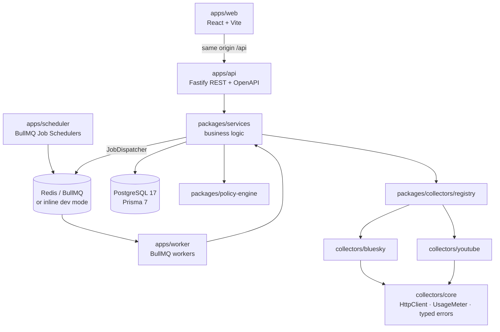

# Architecture (as built: Phase 1)

The architecture is a modular monolith with background workers, built API-first. Reference: Master Plan §3. The decisions behind it are recorded in [`adr/`](adr/).

## Packages

| Package | Master Plan module | Responsibility |
|---|---|---|
| `packages/collectors/core` | M05 | Adapter contract, canonical types, typed errors, HTTP client (retry, Retry-After, SSRF allowlist), usage meter, redaction, schemas |
| `packages/collectors/{bluesky,youtube}` | M05 | Platform adapters |
| `packages/collectors/registry` | M05 | Maps a provider ID to its adapter factory, credential reference and daily cap |
| `packages/config` | — | Configuration from environment variables, validated with zod. No hard-coded ports or secrets |
| `packages/shared` | — | Job states, API error envelope, cursors, platform detection, formula-injection guard |
| `packages/database` | M07 | Prisma schema and migrations, client factory, embedded PostgreSQL, seeding from capability records |
| `packages/queue` | M06 | Queue catalogue, payload schemas, idempotency keys, BullMQ and inline dispatchers |
| `packages/policy-engine` | M13 | Effective data policy and allow/deny decisions (deny by default) |
| `packages/services` | M01, M04, M06, M07 | Projects, account tracking, sync pipeline, post queries, jobs, providers, usage guard, job processor |
| `apps/api` | M12 | REST `/api/v1`, OpenAPI at `/api/docs`, health checks, serves the UI in native mode |
| `apps/worker` | M06 | BullMQ workers (concurrency set per queue) |
| `apps/scheduler` | M06 | Syncs schedules from the DB into BullMQ Job Schedulers |
| `apps/web` | M11 | Minimal UI. The full dashboard arrives in Phase 5 |
| `tools/feasibility` | Phase 0 | Proof-of-concept CLI that runs against real providers |
| `tools/local` | M — ops | Native start/stop, doctor, migrate-seed, real-data vertical slice |

## Request and job flow: track an account
1. `POST /api/v1/accounts {input}`. The platform is detected from the URL. The provider must be enabled (Phase 0 gate) and within its daily quota.
2. `adapter.resolveAccount()` makes one real call. The service then upserts `social_accounts` plus the latest `account_metrics` (respecting policy), links the account to `project_accounts` as APPROVED (a manual add), and writes an audit log entry.
3. A `jobs` row (QUEUED) is inserted under a unique key for active jobs, then dispatched (BullMQ `jobId` = DB id).
4. The worker or inline processor runs `SyncService.syncAccount`:
   1. Fetch the profile.
   2. For each page: upsert posts and metrics and advance the checkpoint, all in one transaction.
   3. Stop when the data is caught up or the cap is reached.
   4. Record `collection_runs` and `usage_logs`.
5. The client polls `GET /api/v1/jobs/:id`, then reads `GET /api/v1/posts?accountId=…`.

## Runtime modes
- **Native** (default): embedded PostgreSQL, plus Redis or Memurai if one is installed (otherwise inline mode). See ADR-0008.
- **Docker** (optional): `docker-compose.yml`. See DEPLOYMENT.md.

## Built in later phases (not yet implemented)

| Phase | Planned work |
|---|---|
| 3 | Keyword engine, discovery |
| 4 | Workflow engine and budget engine |
| 6 | Analytics, AI and trends |
| 5, 7 | Reports and exports |
| 7 | MCP and notifications |

The REST routes for these features already exist and return `501` with the phase number.
